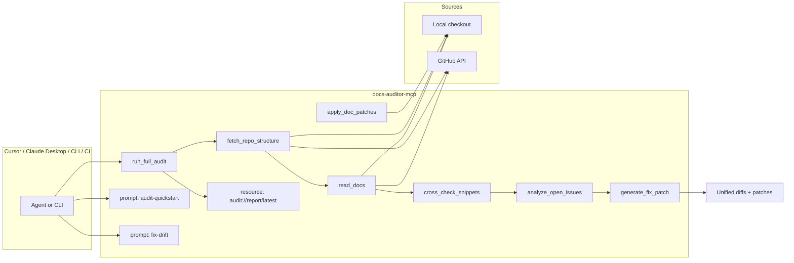

# Docs Auditor MCP

[](LICENSE)
[](https://www.typescriptlang.org/)
[](https://modelcontextprotocol.io/)
[](#scripts)

**Production-grade Docs & Quickstart Auditor** — an MCP server + CI-friendly CLI that catches documentation drift before developers do.

Broken quickstart commands, invented file paths, missing exports, env-var gaps, arity mismatches, and open GitHub docs issues — surfaced as structured findings, unified diffs, and optional safe patch application.

```bash
npm install
npm test
npm run audit:fixture
```

Exit code `2` when `--fail-on` thresholds are hit (default: `high`). Exit code `0` means clean for that threshold.

---

## The problem

Developer products lose adopters when the README lies.

A quickstart that says `npm run start:dev` after the script was renamed to `dev` is not a content problem — it is a **docs/code consistency** problem. The same goes for renamed exports, undocumented `process.env` keys, and prose links to docs that were never written.

This project turns that check into **MCP tools, prompts, and resources** an agent can call — no LLM inside the auditor itself.

---

## Architecture

Seven-step multi-tool flow (plus patch apply):



**Deterministic checks:** repo tree, `package.json` scripts, export/import parsing, call arity, env-var drift vs README/`.env.example`, GitHub docs issues.

---

## Quickstart

### Prerequisites

- Node.js 20+
- Optional: `GITHUB_TOKEN` for higher GitHub API rate limits

### 1. Install

```bash
git clone https://github.com/saikattanti/docs-auditor-mcp.git
cd docs-auditor-mcp
npm install
```

### 2. CLI — audit the bundled fixture

```bash
npm run audit:fixture
# or with CI flags:
npx tsx src/cli.ts --path fixtures/drifted-sdk --format markdown --fail-on high
```

### 3. CLI — audit a local path

```bash
npx tsx src/cli.ts --path /path/to/your/repo --format json --out audit.json
```

### 4. CLI — audit a public GitHub repo (API, no clone)

```bash
npx tsx src/cli.ts --github expressjs/express --format json --fail-on critical
# GitHub URLs also work:
npx tsx src/cli.ts --path https://github.com/expressjs/express --format markdown
```

### 5. Cursor MCP setup

```json
{
  "mcpServers": {
    "docs-auditor": {
      "command": "npx",
      "args": ["tsx", "/absolute/path/to/docs-auditor-mcp/src/index.ts"],
      "env": {
        "GITHUB_TOKEN": ""
      }
    }
  }
}
```

Then try:

- Tool: `run_full_audit` on a local path or GitHub repo
- Prompt: `audit-quickstart` for a DevRel-ready prioritized fix report
- Prompt: `fix-drift` for a dry-run-first patch workflow
- Resource: `audit://report/latest` for the last structured JSON + markdown report
- Tool: `apply_doc_patches` with `dryRun: true` (default), then `false` to write

stdio mode never uses `console.log` (logs go to `console.error` only).

---

## Real execution traces

### Fixture (intentional drift)

```text
Running docs audit…
  [   7ms] 1. Fetch repo structure — 5 files (local)
  [   1ms] 2. Read documentation — 1 doc file(s), 893 bytes
  [   8ms] 3. Cross-check snippets vs code — 4 snippet(s), 5 finding(s)
  [   1ms] 4. Check prose path references — 1 prose finding(s)
  [   9ms] 5. Check environment variable drift — 1 env finding(s)
  [   0ms] 6. Analyze open docs-related issues — Skipped (local path; pass --github to enable)
  [   0ms] 7. Generate fix patches — 3 proposed patch(es)
Done in 28ms · 7 finding(s) (1 critical)
```

Catches: broken `start:dev` script, invented `createUser` import → suggests `createClient`, missing `docs/auth.md`, undocumented `ACME_REGION`.

Full sample: [`examples/fixture-audit-report.md`](examples/fixture-audit-report.md).

### Real repo — `expressjs/express` (GitHub API)

```bash
npx tsx src/cli.ts --github expressjs/express --format json --fail-on critical
```

```text
  [1795ms] 1. Fetch repo structure — 216 files (github)
  [ 688ms] 2. Read documentation — 2 doc file(s)
  [ 348ms] 3. Cross-check snippets vs code — 11 snippet(s), 1 finding(s)
  [   1ms] 5. Check environment variable drift — 0 env finding(s)
  [ 613ms] 6. Analyze open docs-related issues — 10 open docs-related issue(s)
Done in ~3.4s · 11 finding(s) (1 critical)
```

Notable finding: README documents `npm start`, but `package.json` has no `start` script (critical). Plus 10 open docs-related GitHub issues surfaced for triage.

Saved sample: [`examples/express-audit.json`](examples/express-audit.json).

---

## MCP primitives

| Kind | Name | Purpose |
| --- | --- | --- |
| Tool | `fetch_repo_structure` | Local tree or GitHub git tree |
| Tool | `read_docs` | README + docs |
| Tool | `cross_check_snippets` | Paths, imports, exports, arity, npm scripts |
| Tool | `analyze_open_issues` | Open docs/readme/quickstart issues |
| Tool | `generate_fix_patch` | Before/after doc patches |
| Tool | `run_full_audit` | Full pipeline → markdown/JSON + updates latest resource |
| Tool | `apply_doc_patches` | Unified diff; `dryRun` default `true` |
| Prompt | `audit-quickstart` | DevRel-ready prioritized fix report |
| Prompt | `fix-drift` | Safe dry-run-first patch guidance |
| Resource | `audit://report/latest` | Latest structured report |

---

## CI mode (GitHub Actions)

```yaml
name: Docs audit
on: [pull_request]
jobs:
  audit:
    runs-on: ubuntu-latest
    steps:
      - uses: actions/checkout@v4
      - uses: actions/setup-node@v4
        with:
          node-version: "20"
          cache: npm
      - run: npm ci
      - run: npm test
      - name: Fail on high/critical docs drift
        run: npx tsx src/cli.ts --path . --format json --fail-on high
        env:
          GITHUB_TOKEN: ${{ secrets.GITHUB_TOKEN }}
```

Also see [`.github/workflows/docs-audit.yml`](.github/workflows/docs-audit.yml).

CLI flags:

| Flag | Meaning |
| --- | --- |
| `--format json\|markdown` | Report format (`--json` alias) |
| `--fail-on critical\|high\|medium\|low\|none` | Exit `2` when findings at that severity or worse exist |
| `--path` / `--github` | Local path, GitHub URL, or `owner/repo` |

---

## Project structure

```text
docs-auditor-mcp/
├── src/
│   ├── index.ts                 # stdio MCP entry (console.error only)
│   ├── server.ts                # tools + prompts + resources
│   ├── cli.ts                   # CI-friendly CLI
│   └── lib/
│       ├── audit.ts             # Orchestrator
│       ├── cross-check.ts       # Snippet / export / arity checks
│       ├── env-drift.ts         # process.env vs README/.env.example
│       ├── signatures.ts        # Lightweight export/call parsers
│       ├── patch.ts             # Unified diff + apply
│       ├── report-store.ts      # audit://report/latest backing store
│       ├── github.ts / fs-repo.ts
│       └── ...
├── fixtures/drifted-sdk/        # Intentional drift fixture
├── examples/
│   ├── fixture-audit-report.md
│   ├── express-audit.json
│   └── cursor-mcp.config.json
└── .github/workflows/docs-audit.yml
```

---

## Scripts

| Command | Purpose |
| --- | --- |
| `npm run audit:fixture` | Demo audit on intentional drift |
| `npm run audit -- --path <dir>` | Audit any local checkout |
| `npm run mcp` | Start MCP server on stdio |
| `npm test` | Unit + fixture + MCP registration tests |
| `npm run build` | Emit `dist/` |

---

## Contributing

See [CONTRIBUTING.md](CONTRIBUTING.md). Please follow the [Code of Conduct](CODE_OF_CONDUCT.md). Security reports: [SECURITY.md](SECURITY.md).

---

## License

[MIT](LICENSE) © 2026 Saikat Tanti
